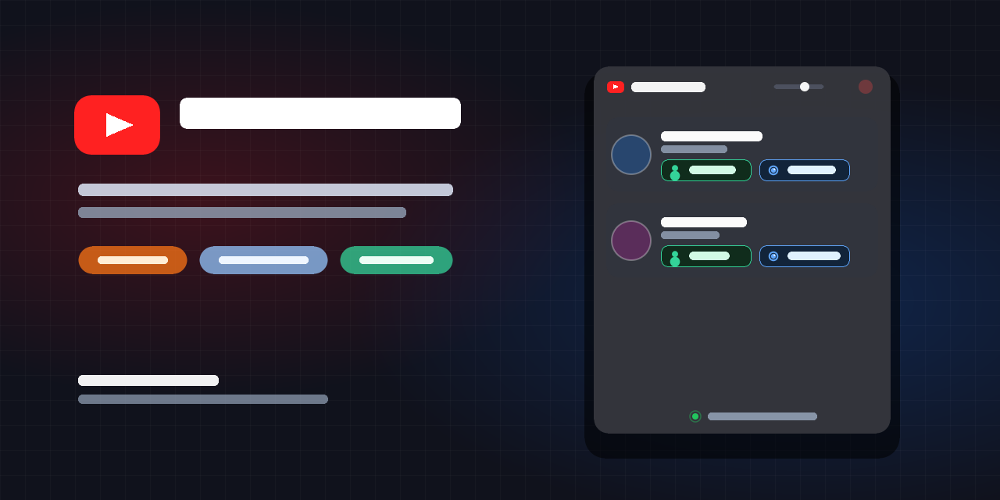
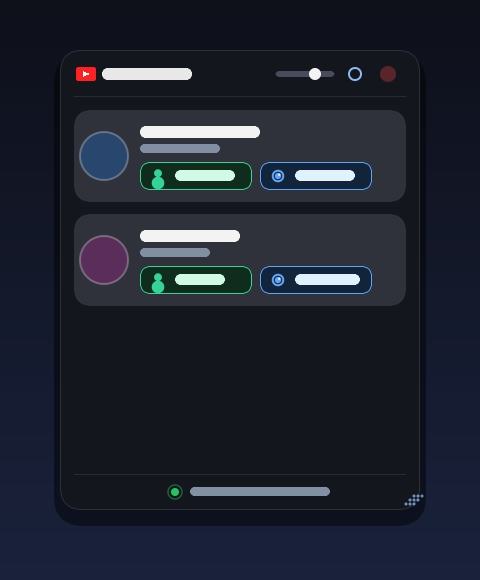
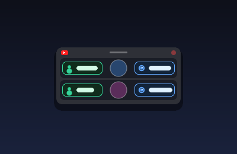

<div align="center">



# 📺 SocialCount

**Un widget desktop moderno, leggero, trasparente e sempre in primo piano sviluppato in Rust per monitorare in tempo reale le statistiche dei canali YouTube.**

[](LICENSE)
[](https://www.rust-lang.org/)
[](https://github.com/matteobaccan/SocialCount)

</div>

---

## 📸 Screenshot

<div align="center">
  <table>
    <tr>
      <td align="center"><b>Modalità Normale (Glassmorphism)</b></td>
      <td align="center"><b>Modalità Ultra-Compatta (Doppio Click)</b></td>
    </tr>
    <tr>
      <td align="center"></td>
      <td align="center"></td>
    </tr>
  </table>
</div>

---

## ✨ Caratteristiche Principali

- **Senza sfondo (Transparent Window)**: La finestra è priva di bordi di sistema ed è trasparente, integrandosi elegantemente sul desktop.
- **Sempre in primo piano (Always on Top)**: Rimane visibile sopra tutte le altre finestre durante il lavoro o il gaming.
- **Interfaccia Glassmorphism ad Alto Impatto**:
  - Contenitore principale a effetto vetro fumé (*frosted glass*) con bordo di riflesso e ombra soffusa (*ambient drop shadow*).
  - Card dei canali fluttuanti con sfondo acrylic scuro.
  - Indicatore live pulsante (*dot verde smeraldo animato in tempo reale*).
  - Logo YouTube vettoriale integrato nella barra superiore.
- **Icone Canale Rotonde**:
  - Immagini profilo dei canali scaricate in background, ritagliate a cerchio perfetto con maschera anti-alias ed evidenziate da un anello di riflesso.
- **Contatori Solidi con Icone Vettoriali Dedicate (Zero Emoji)**:
  - **Pill Smeraldo (Utenti / Iscritti)**: Silhouette profilo vettoriale + solo valore numerico formattato.
  - **Pill Zaffiro (Visualizzazioni)**: Icona occhio con iride e punto luce (*catchlight*) + solo valore numerico formattato.
  - Nessuna parola superflua o etichetta descrittiva e nessun contatore di posizione (`#1`, `#2`).
  - **I box contatori rimangono sempre al 100% solidi e opachi** a prescindere dal livello di trasparenza scelto, garantendo massima leggibilità.
  - **Pari dimensione & reattività**: i due box si adattano proporzionalmente alla larghezza della finestra.
- **Ordinamento per Utenti**: I canali vengono ordinati automaticamente in ordine decrescente di iscritti.
- **Slider Trasparenza Continuo nel Titolo**:
  - Regola in tempo reale la trasparenza dello sfondo da **0% (completamente trasparente)** fino al **100% opaco**. A trasparenza zero scompaiono completamente sfondi e bordi, lasciando visibili soltanto le icone rotonde e i pill dei contatori.
- **Modalità Ultra-Compatta con Doppio Click**:
  - Facendo **doppio click sulla barra del titolo**, la finestra si riduce istantaneamente alla versione ultra-compatta: svaniscono slider, footer e scritte, lasciando solo l'immagine del profilo rotonda al centro affiancata dai contatori su angolo sinistro e destro.
  - Un altro doppio click ripristina la visualizzazione completa.
- **Spostamento Fluido Multi-Schermo**:
  - Spostamento privo di ancoraggi indesiderati (*Aero Snap*) o allargamenti durante il passaggio tra monitor a risoluzioni e DPI differenti.
- **Footer Sticky con Data e Ora**:
  - Mostra il battito live e il timestamp preciso dell'ultimo aggiornamento (es. `02/11/2026 10:45:12`).
- **Configurazione Semplice via TOML (`channels.toml`)**:
  - Legge i canali desiderati direttamente da un file di configurazione modificabile al volo senza ricompilare.
- **Zero API Key richieste**:
  - Estrae pubblicamente le informazioni aggiornate direttamente da YouTube in background tramite worker thread asincrono.
- **Link Diretti**:
  - Cliccando sul nome o sull'avatar del canale si apre la pagina YouTube corrispondente nel browser predefinito.

---

## 🚀 Come Eseguire

### Prerequisiti
- **Rust** (con Cargo): assicurati di avere Rust installato (`rustc --version`).

### Compilazione ed Esecuzione
```bash
# Clona il repository
git clone https://github.com/matteobaccan/SocialCount.git
cd SocialCount

# Esegui direttamente con cargo
cargo run --release
```

Oppure compila l'eseguibile autonomo:
```bash
cargo build --release
.\target\release\socialcount.exe
```

---

## ⚙️ Configurazione (`channels.toml`)

All'avvio, il programma legge il file [`channels.toml`](channels.toml). Se non esiste, viene generato automaticamente con i canali di esempio:

```toml
# File di configurazione SocialCount
# Elenco dei canali YouTube da monitorare (handle con o senza @)
channels = [
    "@matteobaccan"
]

# Intervallo di aggiornamento automatico in secondi (default: 300 = 5 minuti)
refresh_interval_secs = 300

# Trasparenza dello sfondo (0 = completamente trasparente, 255 = opaco, default: 190)
card_opacity = 190
```

---

## 🛠️ Struttura del Progetto

```
SocialCount/
├── Cargo.toml          # Configurazione e dipendenze Rust (eframe, egui, reqwest, serde, toml, image)
├── channels.toml       # Elenco canali YouTube monitorati
├── LICENSE             # Licenza MIT
├── README.md           # Documentazione del progetto
├── assets/             # Logo, banner e screenshot
│   ├── logo.png
│   ├── socialcount-banner.png
│   ├── screenshot-normal.png
│   └── screenshot-compact.png
├── examples/
│   └── generate_assets.rs # Generatore di risorse grafiche
└── src/
    ├── main.rs         # Entrypoint e configurazione viewport trasparente e borderless
    ├── app.rs          # Interfaccia grafica egui, layout responsive e modalità compatta
    ├── config.rs       # Gestione e persistenza della configurazione TOML
    ├── icons.rs        # Rendering vettoriale puro (badge YouTube, user silhouette, eye, live dot)
    └── youtube.rs      # Client HTTP asincrono e parser statistiche canale
```

---

## 📄 Licenza

Distribuito sotto licenza **MIT**. Consulta il file [`LICENSE`](LICENSE) per ulteriori informazioni.

---

## 👤 Autore

**Matteo Baccan**
- GitHub: [@matteobaccan](https://github.com/matteobaccan)
- Repository: [https://github.com/matteobaccan/SocialCount](https://github.com/matteobaccan/SocialCount)
